# Hi, I'm Dmytro 👋

**DevOps engineer from Ukraine.** I automate things so I don't have to touch them twice.

<p>
  
  
  
  
  
  
  
  
  
  
</p>

<picture>
  <source media="(prefers-color-scheme: dark)" srcset="assets/stats-dark.svg">
  
</picture>



## 📄 Resume

```console
$ whoami
Dmytro Tiurikov · DevOps Engineer · Ukraine · remote

$ ./work --history
2025-06 – now      DevOps Engineer @ Adtelligent Inc.
                   ├─ monitoring of an ad-tech (RTB) platform:
                   │  VictoriaMetrics, VMAlert, Alertmanager, Grafana, MetricsQL
                   ├─ scrape inventory as code: Python + Terraform → Prometheus file_sd
                   ├─ configuration management and containers: Ansible, Docker
                   └─ AI-assisted operations with Claude Code
2021-12 – 2022-04  DevOps Engineer @ Dev.Pro
                   └─ cloud administration, automation of services
2020-04 – 2021-03  NOC Engineer @ Provectus
                   ├─ 24/7 monitoring, root cause analysis of alerts
                   └─ troubleshooting by SOPs, incident tracking and escalation
2019-05 – 2019-12  System Network Administrator / IPTV Engineer @ SOHONET
                   └─ IPTV/OTT platform, network monitoring, content delivery automation
2017-02 – 2018-01  L1 Support / IPTV Engineer @ Infomir
                   └─ Ministra TV Platform, MAG set-top boxes, B2B and consumer support
2011-01 – 2017-02  Freelance
                   └─ Linux and Windows servers, websites, SEO, IT consulting
2009 – 2014        earlier: web engineering, PC and network setup, tech support

$ grep -r . ~/skills
containers   Docker  Docker Compose  Kubernetes  LXC  Vagrant
iac          Terraform  Ansible  AWX  Jinja2
ci-cd        GitLab CI  GitHub Actions  Jenkins (Groovy pipelines)
cloud        AWS (EC2, VPC, ALB, S3, ECS, Route 53)  Cloudflare
monitoring   VictoriaMetrics  VMAlert  Alertmanager  Grafana  Prometheus
             Zabbix  custom exporters  promtool/amtool rule tests  Opsgenie
data         ClickHouse
dns          PowerDNS  gdnsd (GeoDNS)  MaxMind GeoIP
networking   TCP/IP  iptables  nftables  Nginx  MikroTik  OpenVPN
             multicast/unicast streaming
linux        Debian packaging  aptly  systemd units/timers  logrotate
             chrony  IPMI  SMART/NVMe
security     nmap scanning  HashiCorp Vault  Ansible Vault
os           Linux (Debian, Ubuntu, CentOS, Arch)  macOS
scripting    Bash  Python (pytest, boto3, openpyxl)  Go (basics)
apis         Grafana HTTP API  Notion API  Telegram Bot API
ai           Claude Code
streaming    Cesbo Astra  Flussonic  ffmpeg  udpxy

$ cat ~/education.log
2004 – 2010  Odessa State Environmental University · Master of Computer Applications
2026         DevOps and Kubernetes. Practical Intensive+ · GlobalLogic × Prometheus
2018 – 2019  DevOps Fundamentals · Hillel IT School
2018         Introduction to Python · Hillel IT School
2016         Manual QA Fundamentals · KeepSolid IT School

$ locale -a | grep -E 'uk|en'
uk_UA   native
en_US   intermediate
```

**Projects**

- [grafana-fleet-hardware](https://github.com/exxmanster/grafana-fleet-hardware) — Grafana dashboard for server fleet hardware from node_exporter, plain PromQL for Prometheus and VictoriaMetrics
- [DP_DevOps4](https://github.com/exxmanster/DP_DevOps4) — AWS blue/green with Terraform, Ansible and Jenkins, region switch for DR
- [Ansible_playground](https://github.com/exxmanster/Ansible_playground) — Ansible roles for a web stack on EC2 with dynamic inventory
- [terraform.DP4](https://github.com/exxmanster/terraform.DP4) — Terraform for AWS: VPC, web and DB instances, state in S3
- [edu-devops-k8s](https://github.com/exxmanster/edu-devops-k8s) — Go server in a multi-arch `FROM scratch` image
- [nginx-loadbalancer](https://github.com/exxmanster/nginx-loadbalancer) — Nginx load balancer in Docker

**Contacts:** [LinkedIn](https://www.linkedin.com/in/dmytro-tiurikov-b01a68113/) · [GitHub](https://github.com/exxmanster)
