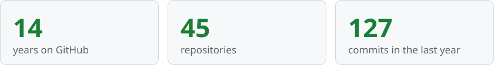

# Hi, I'm Dmytro 👋

**DevOps engineer from Ukraine.** I automate things so I don't have to touch them twice.

  
  
  
  
  
  
  
  
  
  

<picture>
  <source media="(prefers-color-scheme: dark)" srcset="assets/stats-dark.svg">
  
</picture>
